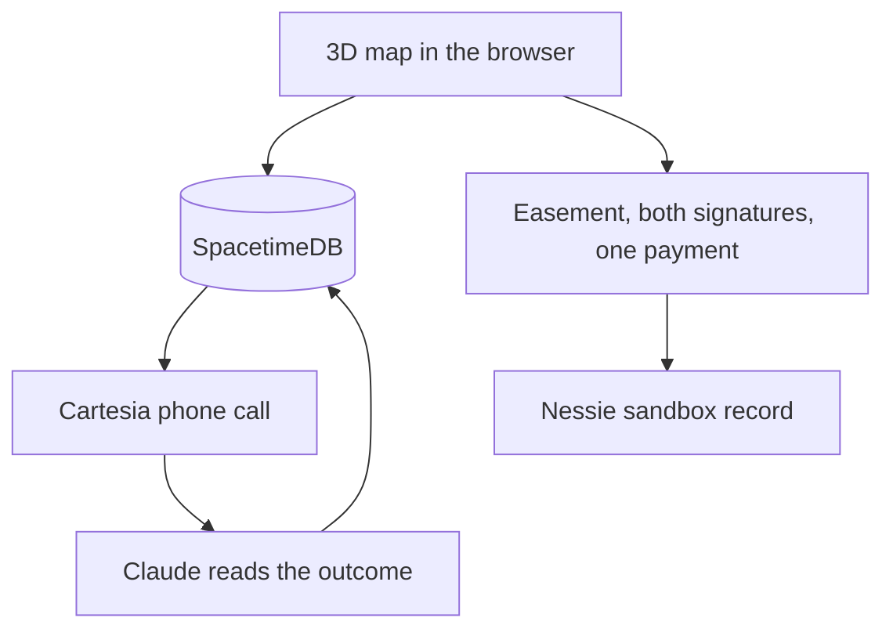
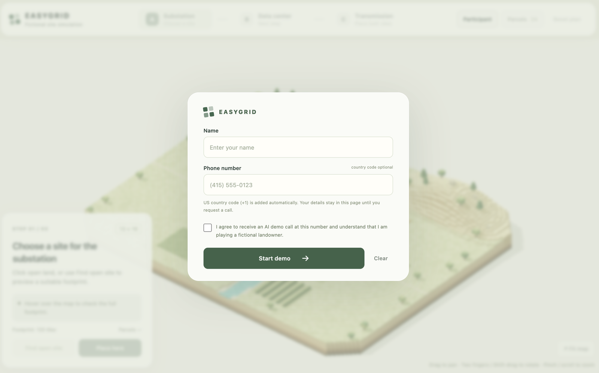
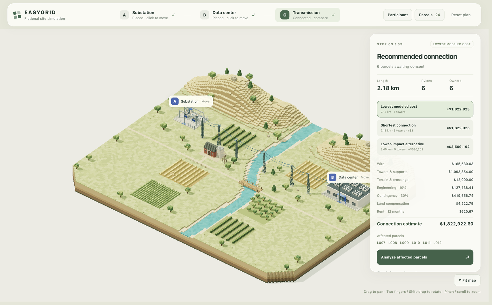
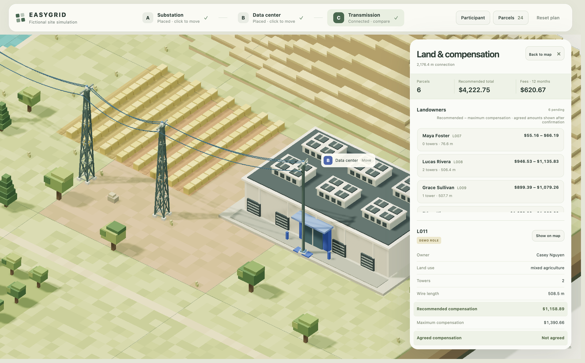

# EasyGrid

Place a substation and a data center on a 3D map. EasyGrid routes the power line, calls the landowner, and settles the easement in one payment.

[](https://easygrid.work)

Cal Hacks 13.0. The live demo is at [https://easygrid.work](https://easygrid.work).

## Stack


The map is a browser app: vanilla JavaScript, a vendored Three.js scene, and Firebase Hosting. Shared contracts are TypeScript. SpacetimeDB holds the live session. Cartesia places the call, Claude reads the outcome, and the contract server can record the payment in the Capital One Nessie sandbox.

## Tracks

EasyGrid is integrated with these Cal Hacks 13.0 tracks. Prize notes and the rest of the sponsor catalog are in [docs/sponsors.md](docs/sponsors.md).

- **SpacetimeDB — Best Use.** The call and its outcome live in one Maincloud database, `easygrid-demo`, so the map and the agent share the same session.
- **Cartesia — Best Use.** The landowner negotiation is a phone call, and the route update follows that conversation.
- **Anthropic — Claude for Public Benefit.** Claude turns the transcript into a structured accept, refusal, or review.
- **Capital One — Best Use of Nessie.** The contract server can write the approved compensation to the Nessie sandbox. The public demo’s payment step is a labeled simulation. A sandbox record stores the amount and does not move funds.
- **Hyphenate — Autonomous Finance.** A supervised finance worker checks the signed agreement, releases one payment per owner, and holds the payout when the amount, recipient, or balance does not match.

## How it fits together



The public site runs the map, the route, and the call. Signing and the payment step run on the local contract server.

## In action

Shots from [easygrid.work](https://easygrid.work). The valley, owners, and dollar amounts are a fictional planning model.



*Start the demo. Consent covers the roleplay call. Land access stays pending until the easement is signed.*



*Place both sites. The planner compares routes and shows a modeled connection cost.*



*Each crossed parcel gets a recommended compensation and a maximum. One parcel is the judge’s fictional owner role.*

## Try it

Open **[https://easygrid.work](https://easygrid.work)**.

1. Enter a name and phone number, check the consent box, and choose **Start demo**. That step does not place a call.
2. Choose **Find open site**, then **Place here**, for the substation. Repeat for the data center.
3. Compare the routes in the panel, then choose **Analyze affected parcels**.
4. **Agent call** places the landowner call for the parcel marked as the demo role.

Signing and the one-time payment need the local server below. On that server, **Simulate approval** opens the easement. Sign both roles on every agreement, then request each owner’s full compensation once.

### Run it locally

Use Node 24, from the repository root:

```sh
npm ci --ignore-scripts --prefix packages/contracts
npm run dev --prefix apps/map-preview
```

Open [http://127.0.0.1:4177](http://127.0.0.1:4177).

Voice keys, the SpacetimeDB CLI, and the Nessie sandbox are documented in [shared setup](docs/shared-setup.md) and [Nessie setup](docs/NESSIE_SETUP.md). Leave those unset to walk the map and the labeled payment simulation.

## What’s next

- Finish settlement on the public site, so signatures and the one compensation payment happen on easygrid.work.
- Let a live refusal redraw the line and negotiate the new parcels in the same session.
- Add a real right-of-way review on top of the labeled simulation checks.

## In the repo

| Piece | Where |
| --- | --- |
| Map planner | [apps/map-preview](apps/map-preview/README.md) |
| Shared API contract | [packages/contracts](packages/contracts/README.md) |
| Cartesia calls | [services/cartesia](services/cartesia/README.md) |
| Claude review | [services/claude-api](services/claude-api/README.md) |
| SpacetimeDB module | [services/spacetimedb](services/spacetimedb/README.md) |
| Hosting | [docs/FIREBASE_HOSTING.md](docs/FIREBASE_HOSTING.md) |
| Contributor workflow | [AGENTS.md](AGENTS.md) |
