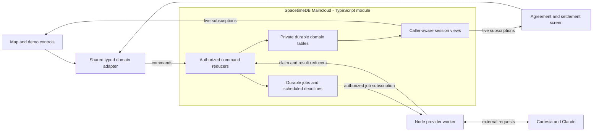

# CAL-29: SpacetimeDB integration architecture

Status: proposal for discussion. October 24, 2026. Documentation only; no
module, worker, endpoint or deployment described here has been implemented.

Inputs: user-provided local `docs/overview.md` and `docs/tracks/spacetime.md`,
[platform research](spacetimedb-research.md), [CAL-29 scope](cal-29-scope.md),
and CAL-27's shared contract/handoff work, now included on remote main by PR #8.

## Recommended decision

Make SpacetimeDB the application's shared workflow engine: it owns durable
state, validates transitions and synchronizes authorized clients. Use one
small Node worker for external voice/AI operations through existing adapters.
The worker has no independent authoritative project store.

The visible SpacetimeDB-enabled behavior is: a landowner response changes the
project, invalidates obsolete actions and updates the map and settlement
screens from the same committed state, without refresh or application polling.
Route calculation may complete in a subsequent transaction; show replanning
explicitly rather than displaying an old route as approved.

Static frontend hosting remains an ordinary frontend concern. The design does
not add Redis, a second domain database, a separate message broker or a custom
WebSocket broadcast server.

## Responsibility boundaries

| Component | Owns | Authority limit |
| --- | --- | --- |
| Browser map/UI | Rendering, transient interaction, command submission | Cannot declare accepted terms, approval or successful payment |
| Shared contracts | Domain shapes, validation, pure policy/math and transport mapping | Pure helpers alone do not establish identity or persistence |
| SpacetimeDB module | Sessions, world reference, policy checks, roles, revisions, workflow and ledger | Does not run network calls inside reducers |
| Provider worker | Existing Cartesia SDK, Claude requests, bounded status retrieval, result submission | Cannot bypass module gates or directly edit tables |
| Optional compatibility facade | Translate existing HTTP clients to shared commands/read projections | No business rules or mutable project state of its own |

Reuse `services/spacetimedb/` for connection configuration. Proposed module
code belongs under `services/spacetimedb/module/`, with bindings generated from
that module and consumed by the domain adapter and worker. A proposed
`services/agent-worker/` would reuse `services/cartesia/` and the future Claude
adapter. These are proposed locations, not existing exports.

Pin module SDK, client SDK and CLI/bindings generation to the verified 2.13.0
baseline. Validate bundling of shared Zod/policy helpers into the V8 module
before committing to import paths. Separate transport/persistence mapping from
domain rules; do not fork the business model if a build boundary needs repair.

## Data ownership and model

Use regular private tables for durable data. The names below describe logical
records; final column definitions follow agreement on CAL-27's revised commands.

| Record group | Essential contents and invariants |
| --- | --- |
| World/owners/parcels | Trusted synthetic world version, coordinate/unit convention, geometry and fictional owner/recipient references |
| Session/project | IDs, active/closed status, current domain revision, facility placements, budget, comparison horizon and simulated date |
| Membership/role binding | Authenticated identity, session, application role; original roleplay owner/parcel and refusal history |
| Private participant | Name/phone, consent evidence and opaque contact reference; no payout-identity override |
| Routes/terms | Current route/version, affected parcels, costs, constraints and per-parcel exact agreed terms/version |
| Calls/negotiations | Attempt/job IDs, session/route/owner/terms binding, technical call state, confirmation evidence and business outcome |
| Agreements/approval | Immutable artifact/version/hash, simulated signatures and approval binding to all current route/terms/contract versions |
| Completion | Explicit simulated completion identity/date and current approved package |
| Obligations/ledger | Stable business key, amount/basis/recipient, simulated settlement records and reconciliation results |
| Command receipts/audit | Actor-scoped request identity, canonical fingerprint, original result/revision; redacted persistent history |
| Jobs/deadlines | Kind, immutable input version, status, lease/fencing generation, dispatch marker, provider reference and deadlines |

Index session-owned rows by session ID, memberships by identity/session, jobs
by status/assigned worker and receipts by their scoped key. Caller-aware views
use indexed lookups. Use a synthetic primary/unique key for compound business
identities where necessary; delimiter-based concatenation must not collide.

Publish only redacted projections through views such as session progress,
route/parcel state, negotiation summaries, agreements, ledger and audit. Views
must check membership for their requested session. A browser's WHERE filter is
an efficiency choice, not an access boundary. Private worker views expose only
the jobs and contacts its role requires.

Keep static rendering assets in the frontend. Persist the selected trusted
world/version and consequential placement/route data; do not stream every
render frame or let a submitted world packet redefine caps and constraints.

## Identity and enrollment

Use a distinct identity/token per client and per worker. Never ship the backend
application token or CLI deployment credentials in a browser bundle.

For the hackathon, server-issued client identities plus explicit session
membership are sufficient. An owner-authorized bootstrap registers the demo
operator/manager and worker identities; ordinary clients cannot grant themselves
roles. The operator can enroll a second read-only screen for the demo. If using
invite tokens, make them short-lived, single-use and server-validated.

SpacetimeAuth is the managed sign-in option if durable human accounts are
needed; it does not replace membership/role checks. CLI collaborator access is
separate from application permissions.

The participant contact form writes to private records over an authenticated,
authorized command. Public progress includes a fictional alias and contact
reference only. Raw contacts/transcripts never enter public receipts, error
messages, audit rows or logs. Restrict transcript storage to what the negotiation
needs and keep any raw evidence worker-authorized. Administrative access remains
privileged; do not claim encryption or retention guarantees we have not verified.

## Command and response protocol

Domain commands carry session/project identity, expected revision, relevant
entity versions and a request key. Actor identity comes from the connection,
not an actor ID supplied in the command. Names below are proposed capabilities,
not claims that CAL-27 already exports them.

| Capability | Caller | Important checks |
| --- | --- | --- |
| Start/import session, place facilities | Operator | Trusted world, footprint validity, canonical ID mapping |
| Bind participant and request call | Operator | Original affected parcel, contact registration, explicit consent, no refusal lockout |
| Claim job / mark dispatch / report result | Worker | Worker role, lease generation, attempt identity and version binding |
| Accept structured negotiation outcome | Worker/operator with appropriate role | Confirmation evidence, exact terms, offer cap, budget, allowed transition |
| Replan | Operator or authorized workflow action | Refused parcel excluded, original participant role preserved, current inputs |
| Create agreement / simulate signature | Agreement workflow role | Every final-route parcel accepted; current immutable agreement version |
| Approve | Manager | Current complete signed package and recalculated costs |
| Simulate tranche/completion/month/reconciliation | Authorized operator/settlement role | Approval, completion order, stable obligation and immutable monetary basis |
| New Demo | Operator | Close prior session, isolate callbacks, clear contacts and create a fresh session ID |

Each mutation follows this order:

1. Authenticate and authorize access to the command/session.
2. Look up its durable actor/session/operation/request-key receipt. Matching
   fingerprint returns the original result; different payload is a conflict.
3. Load current state and validate revisions, versions and transition policy.
4. Validate independent business uniqueness, such as a settlement obligation.
5. Atomically write the domain change, receipt, redacted audit and any new job.

Authorized replay precedes stale-revision checks so a successful retry returns
its original outcome. Replay is not permission to retrieve another actor's data.
Unexpected reducer failure rolls back all writes; do not attempt to persist a
failure receipt and then throw in the same transaction.

Generated TypeScript reducers return `Promise<void>`, not the shared API's JSON
response body. The adapter observes a caller-scoped receipt containing the
original response and committed revision. Subscribe before dispatch, correlate
by request identity and bound the wait. A timeout means unknown until a receipt
lookup establishes the result. Map known domain failures to shared error codes;
do not guess outcomes from an arbitrary runtime error string.

A thin HTTP facade may temporarily implement existing `ContractApi` transport
for consumers that need it, using authenticated callers and the same reducers
and receipts. Prefer direct SDK commands/subscriptions for new UI integration.
Do not use a shared worker credential to turn client-supplied actor IDs into
manager authority.

## Negotiation and refusal flow

1. The operator requests a call; a reducer validates consent and current role,
   persists the attempt and creates its job in one transaction.
2. The worker discovers ready jobs through its subscription, including the
   initial restored rows. A reducer atomically claims one with a lease and
   fencing generation. Only one claimant may dispatch it.
3. Before the external request, persist a dispatch marker. Resolve the private
   contact only for this authorized attempt. Call Cartesia outside a transaction.
4. Persist the provider call ID when known. Retrieve technical status/transcript
   with bounded reads, then ask Claude for a structured proposal. Provider status
   is separate from landowner acceptance.
5. Submit an evidenced result tied to the immutable attempt and current
   session/route/terms. The module validates the business decision and applies
   it atomically; unknown or ambiguous results remain pending/review-required.
6. Refusal records the parcel exclusion, invalidates affected approvals/actions
   and marks replanning needed. It never rebinds the judge or silently authorizes
   another call. Publish the new route only after current inputs are validated.

Use Theo's reusable deterministic routing/cost logic inside the module where
its bundling and runtime cost permit. Until that validation, a trusted routing
adapter may submit a candidate bound to input versions; the module still checks
world, intersections, exclusions, cost and budget before publishing it. Browser
previews are provisional, and route-algorithm work remains Theo's scope.

Claim/deadline bookkeeping has its own attempt revision; it should not create
unnecessary project-domain conflicts. Business outcomes still check the actual
project/route/terms versions. A result that is obsolete may be recorded privately
as stale evidence but cannot advance the current project.

## External effects and recovery

Durable jobs are an application pattern built on SpacetimeDB tables/reducers,
not a claim of a managed exactly-once queue product.

| Failure point | Required behavior |
| --- | --- |
| Worker stops before dispatch marker | Expired lease may be reclaimed safely after server validation |
| Stops after dispatch marker, before request or before saving provider ID | Outcome is uncertain; do not automatically redial |
| Provider call ID known | Reconcile status using that ID; do not create another call |
| Duplicate result delivery | Deduplicate by provider event/attempt identity and fingerprint |
| Old worker returns after lease handoff | Fencing generation blocks obsolete work; reconciliation handles old provider evidence |
| Demo closed or relevant versions changed | Preserve isolated evidence as appropriate; reject current-state mutation |

When the provider does not offer a verified idempotency or lookup mechanism,
the uncertain dispatch gap requires operator reconciliation. We cannot promise
exactly-once phone calls. A deadline marks the attempt unknown and creates
reconciliation work; it must never turn uncertainty into acceptance or a new
live call.

Use native schedule tables for lease/deadline transitions. Status retrieval may
poll the external provider at a bounded rate because the existing adapter offers
`getCall`; UI updates still come from subscriptions. Read-only retrieval and
explicitly safe AI retries can use backoff. Persist all outstanding work so a
worker restart can discover it from subscribed rows, not only insertion events.

Procedures could later replace a bounded external request with:
claim in `withTx` → HTTP outside the transaction → validate/store in another
`withTx`. Retain the same job identity and uncertainty rules, and choose one
executor per job kind. Do not import the Node Cartesia SDK into the module
without a verified runtime compatibility path.

## Settlement and simulated time

Load current approved immutable contracts in the settlement reducer. Derive
amounts using shared helpers; never accept the browser's payment amount.

- Contract tranche: `floor(compensationCents / 5)`.
- Completion balance: the exact compensation remainder, after completion.
- Monthly fees: separate from compensation, using completion-anchored calendar
  periods and the same comparison horizon as the route model.

Uniquely enforce CAL-27's stable obligation identity: session, parcel, stage and
optional rental period. A changed request key or regenerated contract cannot
create another payment. Store the paid amount, terms, owner/recipient, route,
horizon and completion basis with the obligation. Freeze settled monetary terms;
later adjustments/refunds require a separate designed workflow.

For this demo, simulated payment, ledger entry, receipt and audit can commit in
one reducer transaction because no bank is contacted. This atomicity does not
extend to a future real payment provider.

Keep simulated time separate from server real time. An authorized Advance Month
command moves the demo calendar and evaluates due obligations; repeated execution
cannot pay the same month twice. Do not schedule actual month-long waits or use
client clock changes as authority. CAL-38/39 own completion/rent behavior, with
CAL-29 persisting and enforcing its shared transitions.

## Reconnect, New Demo and outages

Configure the existing connection helper's generated builder with explicit
automatic reconnect and confirmed reads. Preserve each client's identity and
restore subscriptions. Persist the last session reference as navigation state,
then verify membership/current server state after reconnect. The SDK cache is
a replica, not the durable authority.

The UI distinguishes connecting, synchronized, reconnecting and unavailable.
Disable mutations while disconnected or before subscription readiness. Treat a
lost command response as unknown and query its receipt using the same key.

New Demo atomically closes the previous session, prevents old jobs from
advancing it and creates a fresh session. Retain prior redacted results for the
result/history view; delete private participant contact records and unlink them
from the new run. Cleanup of stored contacts does not cancel a phone call
already in flight or prove provider-side erasure.

If Maincloud is unavailable, block mutations. An operator-selected standalone
fixture demonstration is separate and explicitly marked not persisted; never
present a local cache as saved shared state.

## Compatibility and implementation sequence

CAL-28 setup and the shared map/contracts baseline are now on remote main.
PR #8 merged at `ac9785cc595068f0df77f06ef25adda577f6b2e0`, incorporating
PR #7/#3/#1. The relevant API/policy/owner-handoff files match the inspected
PR #7 head. This documentation branch still starts from the earlier setup main;
refresh its code baseline before implementation. CAL-27 remains In Progress:
its owner-handoff helpers are additive to a legacy HTTP API using deposit/rent,
and full world/session/command migration and teammate review remain open. Agree
that interface before generating the durable module schema. Do not silently
equate the 20% tranche with a legacy separate deposit.

Proposed slices, each producing a reviewable demonstration:

1. Agree the revised command/read interface, authority boundaries and membership
   bootstrap. Verify V8 bundling and publish an isolated module skeleton.
2. Persist one session with caller-aware views; demonstrate two clients and
   refresh restoration. Generate and pin bindings from the actual module.
3. Add receipts, revision/authorization checks and transactional rollback tests.
4. Add durable call jobs, worker claims, result guards and real-time negotiation
   updates. Keep deterministic fixture mode distinct from the live path.
5. Integrate agreement/completion/simulated-ledger operations with Stella;
   enforce stable obligations and the demo clock.
6. Verify Maincloud recovery, duplicate/stale rejection, privacy and migration;
   record actual deployment/check evidence in CAL-29.

Before the first shared publish, record the actual database name/identity,
deployed commit, generated schema version and collaborator access. Add module
logic tests using `spacetimedb/server/test-utils`, plus actual-service checks.
Test compatible republish against saved state; do not clear the shared database
as a migration shortcut. Monitor actual module/resource use rather than infer
capacity from the reported account energy balance.

## Proposed judge demonstration

In under a minute, using a prepared session:

1. Open the map and settlement/status screen as separate authorized clients.
2. Apply an evidenced refusal from the consented live-call path, or explicitly
   select a labeled simulated refusal when demonstrating the backup.
3. Show both screens update: refused parcel excluded, approval blocked and new
   route/cost arriving after replanning. No manual refresh.
4. Refresh the second screen and show the same saved project. On a prepared
   approved example, repeat a simulated payment with a different request key and
   show one ledger obligation. Reject a stale command without a partial change.

Suggested explanation: SpacetimeDB runs the project rules and synchronizes their
saved results, so a conversation can change everyone's view of the project
without conflicting approvals or duplicate simulated payments.

Completion evidence must also cover unauthorized cross-session reads/writes,
same-key replay/conflict, concurrent duplicate obligations, worker crash gaps,
late callbacks after New Demo, reconnect readiness and a saved-session schema
update. A rehearsed demo is not a substitute for those checks.

## Decisions to review together

- Recommended: TypeScript module + one Node provider worker; native procedures
  remain an alternative executor after measured simplification.
- Recommended: direct authorized UI subscriptions and typed commands, retaining
  a thin HTTP adapter only where an existing consumer needs it.
- Recommended: private tables plus caller-aware views; explicit demo memberships
  initially, managed human sign-in if needed later.
- Still to settle with Theo/Stella: revised CAL-27 command surface, route-code
  bundling boundary and bootstrap/operator identities. No product acceptance
  item is complete merely because this proposal is written.
